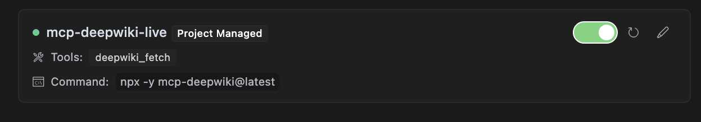

# Deepwiki MCP Server

**Maintenance has ended.** The unofficial `mcp-deepwiki` npm package is deprecated.

In version 0.0.10, starting the server with `--sse` or `--http` opens a network listener without restricting it to localhost or requiring authentication. Version 0.0.11 disables both flags and supports local stdio only.

If you use either network mode, stop the running process. To migrate, remove the old `mcp-deepwiki` startup entry from your client and follow the [official DeepWiki MCP setup guide](https://docs.devin.ai/work-with-devin/deepwiki-mcp).

<details>
<summary>Historical documentation for the discontinued server</summary>

This is an **unofficial Deepwiki MCP Server**

It takes a Deepwiki URL via MCP, crawls all relevant pages, converts them to Markdown, and returns either one document or a list by page.

## Features

- 🔒 **Domain Safety**: Only processes URLs from deepwiki.com
- 🧹 **HTML Sanitization**: Strips headers, footers, navigation, scripts, and ads
- 🔗 **Link Rewriting**: Adjusts links to work in Markdown
- 📄 **Multiple Output Formats**: Get one document or structured pages
- 🚀 **Performance**: Fast crawling with adjustable concurrency and depth
- **NLP**: It's to search just for the library name

## Usage

Prompts you can use:

```
deepwiki fetch how can i use gpt-image-1 with "vercel ai" sdk
```

```
deepwiki fetch how can i create new blocks in shadcn?
```

```
deepwiki fetch i want to understand how X works
```

Fetch complete Documentation (Default)
```
use deepwiki https://deepwiki.com/shadcn-ui/ui
use deepwiki multiple pages https://deepwiki.com/shadcn-ui/ui
```

Single Page
```
use deepwiki fetch single page https://deepwiki.com/tailwindlabs/tailwindcss/2.2-theme-system
```

Get by shortform
```
use deepwiki fetch tailwindlabs/tailwindcss
```

```
deepwiki fetch library

deepwiki fetch url
deepwiki fetch <name>/<repo>

deepwiki multiple pages ...
deepwiki single page url ...
```

## Cursor

Add this to `.cursor/mcp.json` file.

```
{
  "mcpServers": {
    "mcp-deepwiki": {
      "command": "npx",
      "args": ["-y", "mcp-deepwiki@latest"]
    }
  }
}
```



### MCP Tool Integration

The package registers a tool named `deepwiki_fetch` that you can use with any MCP-compatible client:

```json
{
  "action": "deepwiki_fetch",
  "params": {
    "url": "https://deepwiki.com/user/repo",
    "mode": "aggregate",
    "maxDepth": "1"
  }
}
```

#### Parameters

- `url` (required): The starting URL of the Deepwiki repository
- `mode` (optional): Output mode, either "aggregate" for a single Markdown document (default) or "pages" for structured page data
- `maxDepth` (optional): Maximum depth of pages to crawl (default: 10)

### Response Format

#### Success Response (Aggregate Mode)

```json
{
  "status": "ok",
  "data": "# Page Title\n\nPage content...\n\n---\n\n# Another Page\n\nMore content...",
  "totalPages": 5,
  "totalBytes": 25000,
  "elapsedMs": 1200
}
```

#### Success Response (Pages Mode)

```json
{
  "status": "ok",
  "data": [
    {
      "path": "index",
      "markdown": "# Home Page\n\nWelcome to the repository."
    },
    {
      "path": "section/page1",
      "markdown": "# First Page\n\nThis is the first page content."
    }
  ],
  "totalPages": 2,
  "totalBytes": 12000,
  "elapsedMs": 800
}
```

#### Error Response

```json
{
  "status": "error",
  "code": "DOMAIN_NOT_ALLOWED",
  "message": "Only deepwiki.com domains are allowed"
}
```

#### Partial Success Response

```json
{
  "status": "partial",
  "data": "# Page Title\n\nPage content...",
  "errors": [
    {
      "url": "https://deepwiki.com/user/repo/page2",
      "reason": "HTTP error: 404"
    }
  ],
  "totalPages": 1,
  "totalBytes": 5000,
  "elapsedMs": 950
}
```

### Progress Events

When using the tool, you'll receive progress events during crawling:

```
Fetched https://deepwiki.com/user/repo: 12500 bytes in 450ms (status: 200)
Fetched https://deepwiki.com/user/repo/page1: 8750 bytes in 320ms (status: 200)
Fetched https://deepwiki.com/user/repo/page2: 6200 bytes in 280ms (status: 200)
```

## Local Development - Installation

### Local Usage

```
{
  "mcpServers": {
    "mcp-deepwiki": {
      "command": "node",
      "args": ["./bin/cli.mjs"]
    }
  }
}
```

### From Source

```bash
# Clone the repository
git clone https://github.com/regenrek/deepwiki-mcp.git
cd deepwiki-mcp

# Install dependencies
npm install

# Build the package
npm run build
```

## Configuration

### Environment Variables

- `DEEPWIKI_MAX_CONCURRENCY`: Maximum concurrent requests (default: 5)
- `DEEPWIKI_REQUEST_TIMEOUT`: Request timeout in milliseconds (default: 30000)
- `DEEPWIKI_MAX_RETRIES`: Maximum retry attempts for failed requests (default: 3)
- `DEEPWIKI_RETRY_DELAY`: Base delay for retry backoff in milliseconds (default: 250)

To configure these, create a `.env` file in the project root:

```
DEEPWIKI_MAX_CONCURRENCY=10
DEEPWIKI_REQUEST_TIMEOUT=60000
DEEPWIKI_MAX_RETRIES=5
DEEPWIKI_RETRY_DELAY=500
```

## Docker Deployment (Untested)

Build and run the Docker image:

```bash
# Build the image
docker build -t mcp-deepwiki .

# Run with stdio transport
docker run -i --rm mcp-deepwiki

# Run with environment variables
docker run -i --rm \
  -e DEEPWIKI_MAX_CONCURRENCY=10 \
  -e DEEPWIKI_REQUEST_TIMEOUT=60000 \
  mcp-deepwiki
```

## Development

```bash
# Install dependencies
pnpm install

# Run in development mode with stdio
pnpm run dev-stdio

# Run tests
pnpm test

# Run linter
pnpm run lint

# Build the package
pnpm run build
```

## Troubleshooting

### Common Issues

1. **Permission Denied**: If you get EACCES errors when running the CLI, make sure to make the binary executable:
   ```bash
   chmod +x ./node_modules/.bin/mcp-deepwiki
   ```

2. **Timeout Errors**: For large repositories, consider increasing the timeout and concurrency:
   ```
   DEEPWIKI_REQUEST_TIMEOUT=60000 DEEPWIKI_MAX_CONCURRENCY=10 npx mcp-deepwiki
   ```

## Contributing

We welcome contributions! Please see [CONTRIBUTING.md](CONTRIBUTING.md) for details.

</details>

## License

MIT
